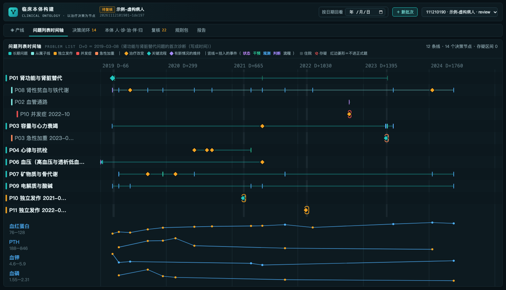
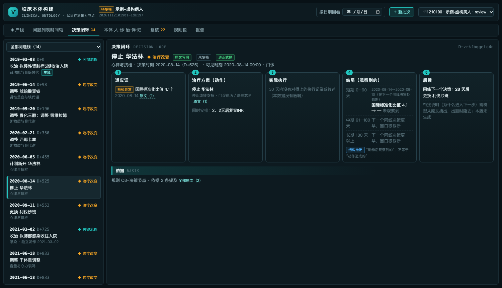
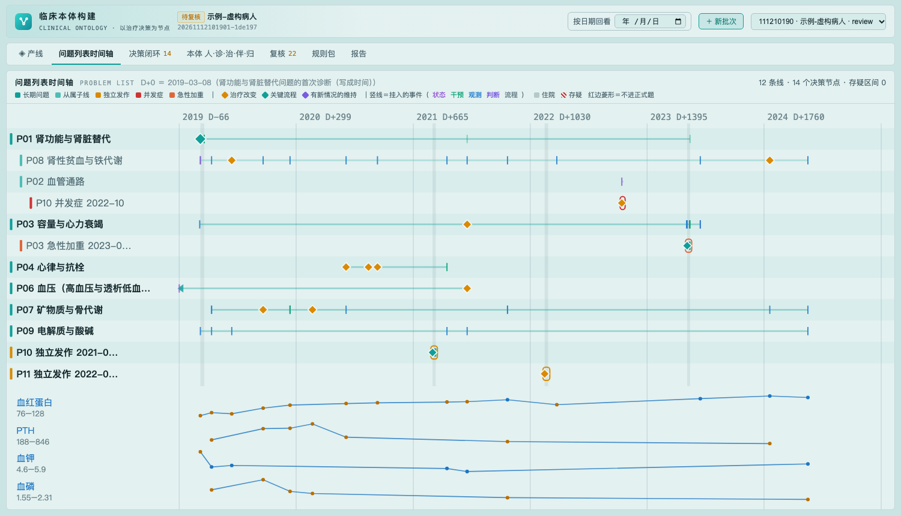

# 临床本体构建 · dsh-medical-ontology

DeepSeek Harness 插件。读入「病历事件还原」(`dsh-medical-event`) 交付的事件包，构建**患者级病程本体：以治疗决策为节点**——按临床问题把事件串成问题线，在线上找出医生做决定的时刻，组装成 适应证 → 方案 → 执行 → 0–90／91–180／180+ 天结局 → 后续调整 的决策闭环，并整理成 人／诊／治／伴／归。每条结论带出处（原文写明／结构推出／模型判断）、依据提及编号、可见时间与医生复核状态。

注意：这里的“临床本体”不是 SNOMED 一类的术语本体。参照 <https://www.g-mpas.com/ontology.html>。

```
医疗数据匿名化 → 病历事件还原 → 【临床本体构建】 → 长病程临床推理评测
                                        └→ 因果链标注、模型训练、数据产品
```





页面跟随 DSH 的深色／浅色主题：



## 用法

- 左侧栏「临床本体构建」：新批次（可直接「用示例（虚构病人）试跑」）、产线、问题列表时间轴、决策闭环、本体 人·诊·治·伴·归、复核、规则包、报告。右上角「按日期回看」只用那一天以前写成的记录即时重算。
- 聊天框：`/ontology <事件包目录> [--out 输出根目录] [--as-of "YYYY-MM-DD"]`，或 `/ontology --demo`。
- Agent 工具：`ontology_start`、`ontology_status`、`ontology_report`、`ontology_runs`、`ontology_cancel`。

安装：`npm i dsh-medical-ontology` 后在 DSH 的插件管理里安装，或从本仓库 `node scripts/build.mjs <版本>` 生成 `dist/<版本>` 再从 profile 安装。

## 产线（v0.1）

| 环节 | 来源 | 做什么 | 本版 |
|---|---|---|---|
| O1 读入 | — | 校验事件包格式与上游验收门；按截止时刻截断 | ✓ |
| O2 问题线 | 工序5 v1.1 | 病种词表挂线（主线/次线）；长期问题、从属子线（只凭原文命名或结构从属）、独立发作、并发症、急性加重；存疑区间；未归线程 | ✓ |
| O3 决策节点 | 工序6 v1.1 | 来源判定、当次写法、同期 7 天；治疗改变、关键流程、有新情况的维持；同次就诊×同线合并；同时安排、患者方决定、佐证、只见转述的决策 | ✓ |
| O4 决策闭环 | 新增 | 适应证（新情况＋写明的理由）、方案、执行佐证、三窗口结局（指标方向 ±10%、新诊断、住院）、到下一同线／主线节点的间隔 | ✓（衔接说明、原因类别待模型） |
| O5 诊断层 | 新增 | 诊断清单、角色候选、确定程度历史、疾病关系（只收原文能说明的） | ✓（角色需医生确认） |
| O6 伴发事件 | 新增 | 主线决策 → 其他方向问题 → 并行决策 → 对主线的影响 | 下一版（模型＋医生） |
| O7 结局归因 | 新增 | 同窗口其他线的治疗改变列为混杂候选 | 候选 ✓；份额待模型＋医生 |
| O8 患者特征 | 新增 | 人口学、意愿与限制因素、器官功能、末次接触 | ✓ |
| O9 医生复核 | — | 确认／驳回，按稳定编号存裁定表，重跑沿用 | ✓ |

只在本机按规则处理，不调用模型；绝不修改输入（运行前后核对文件）。

## 输出

```
<outputRoot>/<输入名>/<病人>/          本体（docs/ontology-schema.md，格式 clinical-ontology/0）
  manifest.json person.json problems.jsonl problem_members.jsonl diagnoses.jsonl relations.jsonl
  decisions.jsonl concurrents.jsonl attributions.jsonl views/
<outputRoot>/_records/
  index.json  review.json（人工裁定，按稳定编号）  runs/<runId>/run.json report.md report.json
```

## 规则包

- 通用层 `rules/general/`：决策节点的来源判定、写法、参数（工序6）。
- 病种层 `rules/specialty/hemodialysis/`：问题线词表 P01–P14、子线归属、主线定义、找线写法（工序5、6）。换病种时加一个病种层。

## 开发

```bash
npm test                                         # 引擎与服务测试（虚构数据）
node scripts/demo/make-demo-package.mjs          # 用 ../dsh-medical-event 重新生成示例事件包
REACT_UMD_DIR=<含 react/umd 的 node_modules> node scripts/preview-page.mjs <状态目录>   # 本地预览页面
node scripts/build.mjs 0.1.0-dev.1               # 生成可安装的 dist/<版本>
```

`demo/` 里的病人是编造的，用来演示与测试；不要把真实病历或其派生内容放进仓库。

## 文档

- [docs/family.md](docs/family.md)：插件家族、拆分理由、共同约定（四个仓库内容相同）
- [docs/brief.md](docs/brief.md)：本插件交接说明
- [docs/ontology-schema.md](docs/ontology-schema.md)：本体格式
- [docs/reference/](docs/reference/)：工序 5–6 设计文档、八道工序总结、G-MPAS 本体页与评测页文本

## License

MIT
